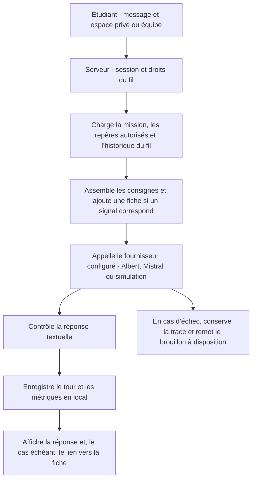

# PTD Coach · La conversation comme point d’entrée

*Note d’état et d’arbitrage du 28 novembre 2026*

L’objectif proposé est qu’un étudiant ouvre PTD Coach, décrive une situation
de son projet et reçoive une aide qui lui permette de faire le prochain pas.
La refonte met le coach en page d’entrée. La qualité du premier échange et
de sa première relance devient la priorité de développement.

## Où en est la version

| Partie | Ce qui fonctionne aujourd’hui | Ce qui reste à démontrer |
| --- | --- | --- |
| Conversation | Démo locale, plusieurs tours, fils privés ou d’équipe, revue d’extrait et accès aux fiches. L’entrée ouvre directement le chat et le premier envoi crée le fil. | Un étudiant doit pouvoir commencer et reprendre une conversation sans aide extérieure. |
| Contexte PTD | Le profil détermine la mission. Dans l’essai Atlas, le stade de la mission est aussi fourni au coach. Les repères de projet sont filtrés par espace et la mission est visible dans le chat. | Le coach doit détecter qu’un sujet saisi diffère de la mission associée, garder le rôle étudiant après une relance et distinguer observation, hypothèse et décision. |
| Posture pédagogique | Dans la recette Atlas, une première réponse a demandé ce qui bloquait ou restait à clarifier. La deuxième a gardé le rôle étudiant. | Elle est devenue trop directive. Il faut vérifier que l’étudiant continue à choisir, interpréter ses preuves et construire ses recommandations. |
| Fournisseurs | Albert et Mistral sont configurables. Chaque appel trace le modèle, la raison d’arrêt et les métriques disponibles. La simulation permet la recette sans API distante. | Les comparaisons disponibles sont exploratoires. Sur Atlas, les deux appels GPT-OSS ont pris 4,7 s et 22,5 s. DeepSeek a atteint le plafond avant tout texte final dans un autre essai. |
| Ressources | La bibliothèque, le projet, les brouillons d’équipe et le point d’étape restent accessibles à partir de la navigation. | Les prochaines améliorations de ressources doivent répondre à une difficulté observée dans le chat. |

Les PR [bibliothèque #18](https://github.com/bdelhomme/ptd-coach/pull/18),
[Albert #19](https://github.com/bdelhomme/ptd-coach/pull/19) et
[essai étudiant #20](https://github.com/bdelhomme/ptd-coach/pull/20)
documentent les étapes précédentes. La refonte s’appuie sur la branche de la PR
#20. La démonstration reste locale et utilise des situations fictives.
[Essai Atlas](PTD_ESSAI_ETUDIANT.md) ·
[Comparaison Albert](../pedagogy/evaluations/ptd-albert-2026-11-27/README.md).

## Ce qui se passe quand l’étudiant envoie un message



Le serveur détermine l’identité, l’équipe et les droits d’accès. Au premier
envoi, le navigateur crée le fil dans l’espace choisi. L’envoi affiche aussitôt
le texte saisi et un état d’attente. En mode API, le fournisseur reçoit un
message système, l’historique de ce fil et la nouvelle demande. Le message
système contient les consignes pédagogiques, les données de mission, jusqu’à
cinq repères confirmés dans l’espace autorisé et éventuellement une projection
courte d’une fiche méthode. La bibliothèque complète et les brouillons
d’atelier sont consultables à part. La réponse finale revient en bloc.
Une clé de requête protège le même envoi contre les doublons. L’étudiant
décide de tout transfert vers un brouillon ou vers un espace partagé.
[Assemblage](../ptd_coach/chat_service.py) · [Projet](../ptd_coach/project.py) ·
[Choix des fiches](../ptd_coach/library_v2.py) · [Transport Albert](../ptd_coach/chat_provider_albert.py).

## Décisions à prendre, dans l’ordre

| Priorité | Arbitrage | Proposition et critère de vérification |
| --- | --- | --- |
| **P0** | Quel rôle pour l’écran d’entrée ? | Valider l’entrée par le coach expérimentée dans cette branche. Après le consentement fictif, une personne peut écrire directement. Sur ordinateur et téléphone, premier message en moins de 30 s, sans explication extérieure. Ce seuil est une cible d’essai. |
| **P0** | Que faire si le sujet saisi et la mission attachée divergent ? | Afficher la mission et conserver sa référence côté serveur. En cas de divergence substantielle, demander à l’étudiant laquelle il explore avant d’utiliser des faits spécifiques. Tester une nouvelle mission, une citation du commanditaire et un « nous » ambigu. |
| **P0** | Quel degré d’aide au premier tour ? | Répondre à une demande explicite. Si la demande n’est pas claire, poser une question courte sur la décision, le blocage ou la prochaine action. Quand le fond de l’étude reste à produire, aider l’étudiant à choisir une observation ou un test. Vérifier au deuxième tour qu’il reste auteur du raisonnement. |
| **P1** | Quel modèle retenir et quelle attente accepter ? | Comparer GPT-OSS via Albert à un modèle Mistral/GLM déjà utilisé avec le même contexte, les mêmes situations et un réglage documenté. Juger fidélité, utilité, latence, troncature et tokens. Évaluer séparément l’intérêt d’afficher la réponse progressivement si le délai réel gêne l’échange. |
| **P1** | Quand faire apparaître ressources et suivi ? | Garder une fiche ciblée à portée de clic quand elle aide à la prochaine action. Tester le retour de jeudi dans un fil puis la reprise de ce fil. Décider à part si un repère mérite d’être conservé entre fils et qui le confirme. |
| **Avant tout pilote** | Avec quelles données et quelles personnes ? | Garder la recette fictive. Avant un essai institutionnel, faire arbitrer l’accès, la conservation des données et le périmètre transmis au fournisseur. Appliquer les règles de séparation privé/équipe et de partage explicite. |

Ce sont des propositions de développement. Les décisions de lancement,
d’évaluation et de pilote restent celles du porteur et de l’équipe pédagogique.
[Décisions existantes](DECISIONS.md) · [Questions institutionnelles](OPEN_QUESTIONS.md).

## Prochaines étapes

1. Faire essayer ce parcours de conversation sur Atlas. Vérifier si la
   personne sait quoi écrire, comprend qui peut lire le fil et sait
   reprendre l’échange. Relever le temps jusqu’au premier envoi.
2. Éprouver six situations fictives sur deux ou trois tours. Couvrir le
   rendez-vous, le cahier des charges, une preuve trop faible, un groupe
   qui décroche, un désaccord et une reprise réflexive après jeudi. Relire
   la deuxième réponse autant que la première. Écarter une version qui
   change de rôle, invente une preuve ou décide pour l’équipe.
3. Comparer les fournisseurs sur ce corpus fixé. Mesurer le délai jusqu’à
   une réponse exploitable et relever les erreurs et troncatures. Décider
   ensuite du modèle de recette et de l’ordre des travaux sur la latence
   et la continuité du fil. Garder une lecture humaine et des verbatims
   fictifs dans les résultats de développement.

## Reproduire l’aperçu

Avec la clé Albert configurée localement :

```sh
CHAT_PROVIDER=albert ALBERT_MODEL=openai/gpt-oss-120b CHAT_MAX_TOKENS=2000 \
  .venv/bin/python -m ptd_coach --essai-etudiant --port 8806 --data-dir local-data/essai-etudiant-atlas
```

[Ouvrir le coach](http://127.0.0.1:8806/). Pour une recette hors réseau,
utiliser `CHAT_PROVIDER=mock` sur un autre port et un autre dossier local.

La recette navigateur en simulation a couvert l’entrée directe, le premier
envoi privé, l’envoi d’équipe au clavier, l’accès aux fils et la revue
d’extrait comme première action. À 390 px, l’écran tient sans débordement
horizontal et la zone de saisie est visible sans défilement. La recette
Albert a ouvert le coach sur Atlas et affiché le modèle configuré.
Les 169 tests automatisés ont passé, hors des deux contrôles qui ouvrent
le jeu réservé. Cette tranche a utilisé la simulation pour les envois de
recette.
